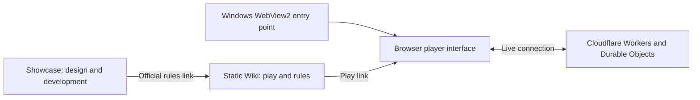

# MFM design and technical tour

[Back to Showcase](README.md) · [繁體中文](DESIGN.zh-TW.md) · [Official Wiki](https://duoduo-88.github.io/monster-fusion-masters-showcase_MFM/en/)

Monster Fusion Masters started as an original physical tabletop game. Its digital development turned that existing board game into a work people can play, watch, review, and share online. This page explains how those achievements fit together.

Basic play, competitive rules, scoring, and special cases belong in the Wiki's [game rules](https://duoduo-88.github.io/monster-fusion-masters-showcase_MFM/en/rules.html) and [modes and competition](https://duoduo-88.github.io/monster-fusion-masters-showcase_MFM/en/modes.html). Start there to reproduce the same rules; this page provides production context and technical concepts.

## From tabletop actions to digital interaction

The physical game uses a board, tiles, and the players' shared reading of the position. The digital version presents those actions and information on screen: selecting a tile, rotating it, previewing placement, and checking turns, scores, and the game log.

The battle interface centers on the board, with the hand and position information around it. Selection, rotation, preview, and placement confirmation are separate interaction stages so players can understand their choice before submitting it. The [standalone examples](examples/README.md) introduce generic hex coordinates and directions.

## How the work fits together

This diagram gives a functional overview of the main parts.

| Part | Role in the project |
| --- | --- |
| Browser interface | Presents the lobby, rooms, board, and player controls, and displays match state. |
| Online multiplayer service | Uses Cloudflare Workers and Durable Objects for rooms, player state synchronization, and spectating; matches use WebSocket connections. |
| Windows desktop version | Hosts the web game in Microsoft Edge WebView2 as a portable Windows x64 entry point. |
| Wiki | Provides bilingual play, rules, and mode explanations using static HTML, CSS, and JavaScript. |
| Showcase | Presents design and production achievements, public materials, and standalone generic examples. |

## Features developed for the digital version

These features make the existing tabletop game easier to experience, share, and review. Consult the Wiki for play instructions and competitive systems; this section explains their purpose in the work.

| Achievement | Design and production focus | Public presentation |
| --- | --- | --- |
| Lobby and multiplayer rooms | Make finding opponents, joining matches, and spectating visible entry points. | [Lobby](assets/lobby.png), [room](assets/room.png) |
| Color Lab | Let players adjust tile colors and patterns, with previews, local saving, and shareable color codes. | [Color Lab](assets/color-lab.png) |
| Match replays | Let players revisit completed matches and import or export match records. | [Wiki feature tour](https://duoduo-88.github.io/monster-fusion-masters-showcase_MFM/en/modes.html#features) |
| AI and competitive features | Provide computer opponents and integrate Ranked, seasons, and knockout tournaments into the online experience. | [Wiki modes and competition](https://duoduo-88.github.io/monster-fusion-masters-showcase_MFM/en/modes.html) |
| Bilingual interface and tutorial | Help players get started through Traditional Chinese, English, and a guided tutorial. | [Chinese Wiki](https://duoduo-88.github.io/monster-fusion-masters-showcase_MFM/), [English Wiki](https://duoduo-88.github.io/monster-fusion-masters-showcase_MFM/en/) |

## Development roles and history

The original creator is responsible for the tabletop design, rules, scoring, balance, and gameplay direction. Codex helps implement the existing design as software, including interface and multiplayer work, code analysis, debugging, and refactoring. The [Showcase home page](README.md) records the development story and major feature milestones.

Public presentation uses actual game screens, existing tabletop photos, and verifiable development records. The feature table describes achievements already presented in the project; it is not a list of planned features.

## Reading and implementation references

1. Read the Wiki's play and competition explanations to establish the rules you intend to use.
2. Use this tour to understand the roles of the interface, online service, and presentation documents.
3. Run the [generic examples](examples/README.md) to see separate representations of coordinates, rotation, and UI state.
4. Check your game's decisions against the Wiki; the examples' coordinates, edge numbering, and data shapes are demonstration conventions.

The public examples run locally without a game account or online service. The complete production source, AI, ranking, and core server systems retain the existing publication scope described in the [Showcase repository overview](README.md).
