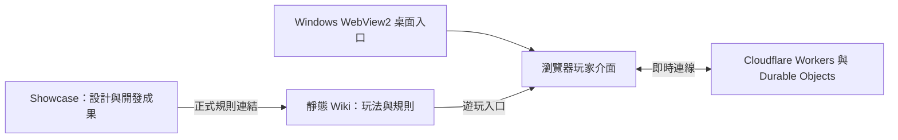

# MFM 設計與技術導覽

[回到 Showcase](README.zh-TW.md) · [English](DESIGN.md) · [官方 Wiki](https://duoduo-88.github.io/monster-fusion-masters-showcase_MFM/)

Monster Fusion Masters 的起點是原創實體桌遊。數位化的工作，是把既有棋盤遊戲轉換為可以操作、觀戰、回顧，並與其他玩家連線的作品。本頁說明這些成果如何組成整個遊戲。

基本玩法、競技規則、計分與特殊判定統一收錄在 [Wiki：遊戲規則](https://duoduo-88.github.io/monster-fusion-masters-showcase_MFM/rules.html)及[模式與競技](https://duoduo-88.github.io/monster-fusion-masters-showcase_MFM/modes.html)。想重現同樣規則的遊戲，可以從這兩篇開始；本頁提供製作方向與技術概念的參考。

## 從實體桌遊到數位操作

實體桌遊用棋盤、棋子與玩家的共同判讀完成一局。數位版本需要把這些操作與資訊呈現在螢幕上：選取手牌、旋轉棋子、預覽落點，以及查看回合、分數與遊戲紀錄。

戰鬥介面以棋盤為中心，將手牌與局勢資訊放在周圍。選取、旋轉、預覽與確認落子是不同的操作階段，讓玩家能在送出操作前理解自己的選擇。六角座標與方向的通用概念，可從[獨立程式範例](examples/README.zh-TW.md)開始閱讀。

## 作品的組成

下圖是功能層級的概覽，方便理解各個部分的用途。

| 部分 | 在作品中的工作 |
| --- | --- |
| 瀏覽器介面 | 呈現大廳、房間、棋盤與玩家操作，顯示對局狀態。 |
| 線上多人服務 | 以 Cloudflare Workers 與 Durable Objects 支援房間、玩家狀態同步和觀戰；對局使用 WebSocket 即時連線。 |
| Windows 桌面版本 | 以 Microsoft Edge WebView2 承載網頁遊戲，提供 Windows x64 免安裝入口。 |
| Wiki | 提供雙語玩法、規則與模式說明，使用靜態 HTML、CSS 和 JavaScript。 |
| Showcase | 展示設計與製作成果，提供公開素材和獨立通用範例。 |

## 數位版延伸出的功能

以下功能讓既有桌遊更方便被體驗、分享與回顧。遊玩方式與競技制度可在 Wiki 查詢；這裡說明它們在作品中的用途。

| 成果 | 設計與製作重點 | 公開展示 |
| --- | --- | --- |
| 大廳與多人房間 | 將找對手、加入對局與觀戰整理成可見的操作入口。 | [大廳](assets/lobby.png)、[房間](assets/room.png) |
| Color Lab | 讓玩家調整棋子色彩與圖案，透過預覽、本機儲存與色彩代碼分享外觀。 | [色彩實驗室](assets/color-lab.png) |
| 對局重播 | 讓完成的對局可以回顧，並支援對局紀錄的匯入與匯出。 | [Wiki 功能介紹](https://duoduo-88.github.io/monster-fusion-masters-showcase_MFM/modes.html#features) |
| AI 與競技功能 | 提供電腦對手，並將 Ranked、賽季與淘汰賽整合進線上體驗。 | [Wiki 模式與競技](https://duoduo-88.github.io/monster-fusion-masters-showcase_MFM/modes.html) |
| 雙語與教學 | 以繁體中文、英文與新手教學幫助玩家進入遊戲。 | [繁中 Wiki](https://duoduo-88.github.io/monster-fusion-masters-showcase_MFM/)、[英文 Wiki](https://duoduo-88.github.io/monster-fusion-masters-showcase_MFM/en/) |

## 開發分工與歷程

原作者負責原創桌遊、規則、計分、平衡及玩法方向。Codex 協助把既有設計實作為軟體，包括介面、多人功能、程式分析、除錯與重構。完整的開發故事與重要功能里程碑收錄在 [Showcase 首頁](README.zh-TW.md)。

公開展示以實際遊戲畫面、既有實體照片與可查證的開發紀錄為依據。功能表描述的是目前作品已呈現的成果；它不是待開發功能清單。

## 閱讀與實作參考

1. 先閱讀 Wiki 的玩法與競技說明，確定要採用的遊戲規則。
2. 從本頁了解數位作品如何分成操作介面、線上服務與展示文件。
3. 執行[通用範例](examples/README.zh-TW.md)，觀察座標、旋轉與介面狀態各自如何表示。
4. 實作自己的版本時，回到 Wiki 核對遊戲判定；範例中的座標、邊編號及資料形狀只是示範約定。

公開範例可直接在本機執行，不需要遊戲帳號或連線服務。正式服務的完整原始碼、AI、排名及伺服器核心系統維持既有的公開範圍，詳見 [Showcase 儲存庫說明](README.zh-TW.md)。
