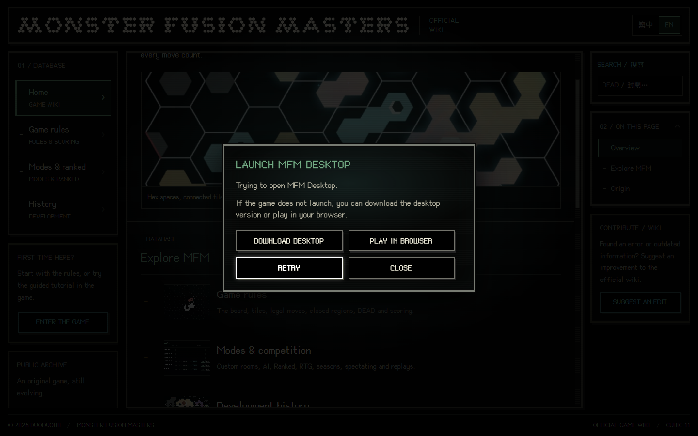
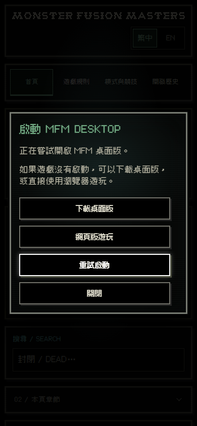

# Desktop-first Wiki entry

Baseline remote `main` was verified on 2026-10-17 as `647bea5eeb9c1ea4a4c50f3aa35fa3282a704034`. Work is on `codex/desktop-launch-popup-20261017`. The existing untracked `.tmp/` directory was preserved and is excluded from this change. No open Showcase PRs existed at the start.

The Chinese and English homepage buttons retain the official browser game in their static `href`. On Windows, an ordinary unmodified click synchronously opens the native modal and attempts `mfmdesktop://launch` in that same user gesture. Non-Windows clients, unsupported dialog implementations, modified-link clicks and disabled JavaScript retain the browser link. The dialog never claims installation, permission or launch success/failure. Browser play is only selected by the player; there is no timer-based fallback or automatic second session.

## Canonical files

| File | Responsibility |
| --- | --- |
| `docs/index.html`, `docs/en/index.html` | Progressive browser link, translated static modal, labels/descriptions, current Release and web-game links; updated CSS/JS cache keys |
| `docs/wiki.js` | One launcher, synchronous explicit protocol attempts, finite 260ms/180ms reveal/reverse animation, Escape, Tab wrapping, focus restoration without scrolling, session listener cancellation |
| `docs/wiki.css` | Existing `.rail-note` and `.pixel-btn` ownership; game-style dialog background, pixel frame, inset shadow, button variables, focus, viewport sizing and responsive actions; no `!important` or new override stylesheet |
| `docs/fonts/BoutiqueBitmap9x9_1.93.ttf`, `BoutiqueBitmap9x9-OFL.txt` | Game's existing pixel UI font and [upstream license](https://github.com/scott0107000/BoutiqueBitmap9x9/blob/7f73672/OFL.txt); existing Cubic 11 remains the reading font |
| `scripts/test-desktop-launch.mjs` | Protocol/refusal/non-Windows/reduced-motion/cleanup/static-link regression tests |
| `scripts/test-desktop-launch-browser.mjs` | Real DOM/cascade/layout/keyboard/scroll/reduced-motion matrix; explicit controlled external-handler refusal |

Visual reference: the game's verified `3eeadba98a403ef62d58d7e3a94e7be5b38f2da8` popup-presentation.js/css, lobby.css, lobby-room-layout.css and index.html. Only necessary presentation concepts are reproduced, with no game runtime dependency. The native `<dialog>` supplies the top layer, modality and inert background. A temporary animated border follows the same center-line/full-surface clipping concept and is removed after each animation. Reduced motion bypasses animation completely. The modal reserves its scrollbar gutter, scrolls internally on short screens, and does not lock or reflow the Wiki document/article/rails. Closing returns focus with `preventScroll`.

There was no old launcher to remove. No alternate controller, CSS override layer, runtime polling, persistent RAF, storage key, server call or heuristic installation detection was added. The additional font is loaded locally when the popup uses it; the image backgrounds are CSS gradients.

## Tests

```sh
node scripts/test-language.mjs
node scripts/test-search.mjs
node scripts/test-media.mjs
node scripts/test-desktop-launch.mjs
```

All 26 tests pass (20 existing plus six new). For browser checks, provide Playwright and installed browser engines; `MFM_PLAYWRIGHT_MODULE` may point to an existing Playwright module directory. Set `MFM_TEST_BROWSERS` to a comma-separated subset of `chromium,firefox,edge`; the default runs all three. `PLAYWRIGHT_BROWSERS_PATH` can select an isolated test-engine directory.

```sh
node scripts/test-desktop-launch-browser.mjs
```

The harness serves the real static pages and CSS, preserving the production script except for replacing the final OS dispatch call with a controlled refusal. It asserts the protocol is attempted while real browser user activation is still active, and verifies neutral choices remain available. This substitution prevents native external-app confirmation windows from consuming Playwright's keyboard tests; it does not claim the OS handler was installed, accepted or launched.

Matrix: both languages at 320×480, 390×844, 900×700 and 1440×900; viewport bounds, text/button overflow, game font, focus/Tab/Escape, retry, reverse close, interrupted opening, reduced motion, unchanged article scroll/document geometry, non-Windows and no-JS fallbacks. Each engine runs ten cases. Screenshots are generated under `.tmp/desktop-launch-validation/` for inspection.

Selected Edge screenshots for review:





All 30 browser cases passed on the Windows host: Chrome for Testing 151.0.7922.34, Firefox 153.0 and Edge 155.0.4283.45, ten cases each. The latest Showcase Release resolved to `v0.1.2` with the Windows x64 ZIP and checksum; the download button intentionally uses `releases/latest`, and no new Release is created. The web-game endpoint loaded in the actual desktop WebView.

Actual Windows ShellExecute registration/handoff, Unicode/space/special-character paths, relocated-path refresh, same-process activation and hostile-argument rejection are covered in the companion desktop branch. Native browser-owned external-app confirmation/denial and unregistered-protocol chooser behavior remain a manual acceptance matrix; controlled refusal tests are not a substitute for those checks. A visible native-prompt inspection was stopped because the computer-use tool could not confidently determine the browser URL; no prompt was accepted. Do not merge or publish automatically.
